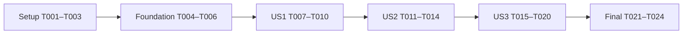

# Tasks: Market Conformance

**Input**: [spec.md](spec.md), [plan.md](plan.md), [research.md](research.md), [data-model.md](data-model.md), [contracts](contracts/market.md), [quickstart.md](quickstart.md).

**Tests**: Required by FR-001, FR-008, FR-009 and constitution. Assess existing implementations first; unchecked means unverified, not necessarily absent. Add or repair only the gaps. Write failing regression tests before corresponding behaviour changes; preserve passing existing tests.

**Global constraints**: No commits, pushes or PRs. Preserve unrelated dirty work. No manual edits to bridge snapshots. No new dependencies; use pinned Python 3.14.10 and uv 0.13.8. Market remains pure and conforms in place. Outside-market production changes are import migration only unless a specific task authorizes more. The spec is binding over this task list.

## Phase 1: Setup

- [ ] T001 Verify the existing linked worktree, branch and 002 prerequisite using `docs/planning/roadmap.md`; run start-work before code edits and record the initial dirty-file inventory and task evidence locations in `specs/005-market-conformance/validation.md`, without resetting existing work.
- [ ] T002 Verify pinned toolchain from `pyproject.toml` and `.python-version`, run `make install` and capture initial `make check-all` results in `specs/005-market-conformance/validation.md`; distinguish pre-existing failures from this feature's remaining work.
- [ ] T003 Identify the committed pre-feature baseline for `rescue/demo.py`, capture its demo stdout as raw bytes in ignored scratch storage using the same pinned environment, and record commit, command and binary artifact location in `specs/005-market-conformance/validation.md`; do not use the dirty implementation as baseline or mark FR-009 passed without trustworthy evidence.

## Phase 2: Foundational prerequisites

**Purpose**: Stabilize interfaces before story work. Reuse existing code and test each constraint; do not rebuild conformant pieces.

- [ ] T004 Assess and complete entity files and category exports in `rescue/market/models/fleet/`, `rescue/market/models/availability/`, `rescue/market/models/procurement/`, `rescue/market/models/quotes/`, `rescue/market/models/offers/`, `rescue/market/models/inventory/` and `rescue/market/models/b3_market.py`; preserve all fields from data-model.md and its constraints: "Positive requested seats", "Positive hold", "Request ID present exactly for acceptance", "Owns immutable revision history", "Highest revision current; old requests retain pinned terms", "Immutable aggregate, tuple collections". Keep RFQStatus pending/quoted/expired and QuoteStatus held/accepted/rejected/expired string-compatible, with construction-time rejection of unknown values. Shared validation remains in `rescue/market/models/named_value.py`.
- [ ] T005 Complete market-owned read-only views in `rescue/market/models/inventory/commitment_source.py` and `rescue/market/models/inventory/commitment_request.py`: source exposes mission_id and requests; request exposes ship_id, requested_seats, confirmed_seats and outcome. No concrete mission imports, including under TYPE_CHECKING; validate with real mission/request values in later pure tests.
- [ ] T006 Finish category import migration in `rescue/application/central.py`, `rescue/application/contracts.py`, `rescue/application/state.py`, `rescue/bootstrap.py`, `rescue/demo.py`, `rescue/experiments/models.py`, `rescue/experiments/results.py`, `rescue/mobilisation/models.py` and callers found by repository search; remove facades in `rescue/market/__init__.py`, `rescue/market/models/__init__.py` and former `rescue/market/rules.py`, preserving aggregate imports from models.b3_market. Migrate corresponding test imports only, retain runtime semantics, and record any additional caller paths before editing them in `specs/005-market-conformance/validation.md`.

**Checkpoint**: Stable category interfaces and existing caller behaviour; all stories may now be tested independently against their own criteria.

## Phase 3: US1 — No seat is counted twice (P1, MVP)

**Goal**: Prove shared capacity accounting under generated mixed operations.

**Independent test**: `uv run pytest tests/unit/market/capacity tests/unit/market/refusals tests/unit/market/rules`; at least 200 reproducible sequences, two real missions and two ships, accounting assertions after every step, no fakes or I/O.

- [ ] T007 [P] [US1] Strengthen `tests/unit/market/capacity/test_generated_sequences.py` to use real immutable mission/request values instead of substitute dataclasses, local seeded Random instances and an independent seat ledger; execute 200+ sequences of 30+ mixed steps over 2+ missions and ships. Exercise holds, transfers, rejected/expired closes, lowered availability, pending refusals and partial acceptance; compare both ships after every successful or refused step and report seed and trace on failure.
- [ ] T008 [P] [US1] Extend `tests/unit/market/refusals/test_refusals.py` for excessive holds, missing availability, duplicate source identities, conflicting same-time publication and repeated/closed transitions; assert whole aggregate and history equality on refusal and zero double release. Distinguish first explicit expiry processing from an attempted transfer or second close of an already expired quote.
- [ ] T009 [US1] Repair only demonstrated accounting gaps in `rescue/market/models/inventory/rules/usage.py`, `rescue/market/models/availability/rules/latest_availability.py`, `rescue/market/models/availability/rules/publish_availability.py` and `rescue/market/models/quotes/rules/hold_quote.py`; preserve "used = held + pending + confirmed", "free = max(0, total - used)" (zero when unavailable), "shortfall = max(0, used - total)", "Missing availability permits no new holds" and "Duplicate mission identities are refused". Retain earlier publications; latest recorded_at wins and "conflicting same-time publication refused". Acceptance transfers preserve usage; reduced availability retains commitments and prevents additional excess holds. Depends on T007–T008.
- [ ] T010 [US1] Run the US1 independent test command and record seeds, sequence counts, no-fakes assessment and accounting results in `specs/005-market-conformance/validation.md`; require zero invariant violations before marking US1 complete.

## Phase 4: US2 — Read market history (P2)

**Goal**: Every successful quote transition remains readable and failed transactions publish nothing.

**Independent test**: `uv run pytest tests/unit/market/history tests/integration/application/market_history`; quote-specific append order, accepted request identity and atomic publication/rollback must pass.

- [ ] T011 [P] [US2] Extend `tests/unit/market/history/test_quote_history.py` for successful HELD→ACCEPTED, HELD→REJECTED and HELD→EXPIRED histories, one entry per successful transition, none on refusal, terminal outcome stability and immutable availability/revision histories. Assert "Request ID present exactly for acceptance" and insertion order with supplied timestamps, without inventing new timestamp-refusal behaviour.
- [ ] T012 [P] [US2] Add `tests/integration/application/market_history/test_market_history.py` through `new_run` and the real memory store: acceptance publishes accepted quote/history and pending request together; an operation that fails after staging leaves the persisted run and all history unchanged. Use existing transaction APIs and no production test hooks.
- [ ] T013 [US2] Complete append-only quote history in `rescue/market/models/quotes/quote_status_change.py`, `rescue/market/models/quotes/rules/hold_quote.py`, `rescue/market/models/quotes/rules/transfer_quote.py`, `rescue/market/models/quotes/rules/close_quote.py`, `rescue/market/models/quotes/rules/quote_history.py`, `rescue/market/models/quotes/rules/_held_quote.py` and `rescue/market/models/b3_market.py`; tuple-replace on success, append exactly once, preserve original state on failure. Retain explicit time inputs and existing closed/expiry policies; clarify readback as append order. If atomic integration tests expose a need for outside-market behaviour changes, document the exact spec conflict before expanding production scope. Depends on T011–T012.
- [ ] T014 [US2] Run the US2 independent test command and record transition, rollback and request-transfer evidence in `specs/005-market-conformance/validation.md`; confirm history changes do not alter seat totals.

## Phase 5: US3 — Standalone, documented market (P3)

**Goal**: Enforce market isolation, named statuses, category imports, per-entity/rule documentation and diagram alignment.

**Independent test**: `make check-architecture` and `uv run pytest tests/architecture/market_layout tests/unit/market/statuses`; reject mission imports even in type hints, unknown statuses and facade exports.

- [ ] T015 [P] [US3] Strengthen `tests/architecture/market_layout/test_market_layout.py` to check one file per entity/status, category-only caller imports, absence of facade re-exports, and each module/class/public-function docstring individually for what/when/why and a diagram reference. Check adjacent rule Markdown for purpose, timing, rationale, refusals and diagram links. Keep architecture tests at the prescribed tier.
- [ ] T016 [P] [US3] Extend `tests/unit/market/statuses/test_statuses.py` for both status enums' complete accepted sets, old-string equality, construction normalization and rejection of unknown values, including quote/history acceptance request-ID constraints.
- [ ] T017 [US3] Enforce FR-004 in the declared market contract in `pyproject.toml` and `tests/architecture/boundaries/test_architecture.py`: market may import its own modules, rescue.values and standard library only. Detect type-only and newly added sibling dependencies; retain the other existing import contracts and ensure the forbidden-import test actually catches a mission type reference.
- [ ] T018 [US3] Complete documentation in `rescue/market/**/*.py` and `rescue/market/models/<category>/rules/<rule>.md`: each required docstring individually states what, when, why and its ShipMarket diagram; each public rule has a same-name file/document listing refusal conditions. Include protocols, enum types, aggregate and helpers without changing behaviour. Depends on T015–T016; one writer owns the whole market scope.
- [ ] T019 [P] [US3] Align `docs/architecture/diagrams/rescue-domain-model/namespaces/ShipMarket/class-diagram.mmd` and `entity-relationship-diagram.mmd` with all six categories, statuses, quote history and inventory views, explicitly distinguishing derived/protocol views from persisted entities. Regenerate corresponding `.svg` artifacts with existing pinned tooling and update `docs/architecture/diagrams/rescue-domain-model/README.md`. This covers existing spec diagrams; the separately proposed process diagram still awaits approval.
- [ ] T020 [US3] Run the US3 independent commands and record import-boundary, enum, layout/docstring and UML/ER consistency results in `specs/005-market-conformance/validation.md`. Depends on T015–T019.

## Phase 6: Polish and cross-cutting evidence

- [ ] T021 Add only meaningful missing branch cases to the appropriate existing `tests/unit/market/<topic>/test_<name>.py` files; run `uv run pytest tests/unit/market --cov=rescue.market --cov-branch --cov-report=term-missing --cov-report=json --cov-fail-under=100` and independently assert zero missing statements and branches from JSON. Record exact totals in `specs/005-market-conformance/validation.md`; no exclusions, pragmas, fakes or I/O to manufacture 100%.
- [ ] T022 Run `make check-all` and compare candidate demo stdout bytes against T003's baseline for `rescue/demo.py`; record exit codes, baseline commit, command and byte comparison in `specs/005-market-conformance/validation.md`. Any failure remains open; do not mark an unavailable baseline as verified.
- [ ] T023 Reconcile documented market assumptions, history ordering and transaction/concurrency explanation in `README.md`, link all feature documents including `tasks.md` and `validation.md` from `docs/readme.md`, and update `docs/planning/roadmap.md` to reflect verified status only; retain the project's docs layout and leave unrelated specs untouched.
- [ ] T024 Execute the complete guide in `specs/005-market-conformance/quickstart.md`, conduct an independent aggregate spec/quality review of the final uncommitted diff, resolve findings and record final FR-001 through FR-009 and SC-001 through SC-005 evidence in `specs/005-market-conformance/validation.md`. No commits or publication.

## Dependencies and execution order

Stories have independent acceptance commands, but the default execution order is P1→P2→P3: US1 and US2 share quote-rule files and US3 documents those finalized files. Do not run their production writers concurrently. Foundation blocks every story. Within US1, T007/T008 precede T009, then T010. Within US2, T011/T012 precede T013, then T014. Within US3, T015/T016/T017 may prepare their disjoint files together; T018 follows T015/T016; T019 follows foundation and may run alongside the US3 test/documentation work; T020 follows all US3 tasks. T021→T022→T023→T024 follow every story. Run gates again if later documentation edits change executable examples or code.

## Parallel examples and ownership

- US1: T007 owns only capacity/test_generated_sequences.py while T008 owns only refusals/test_refusals.py, after foundation. Neither edits shared helpers or production files.
- US2: T011 owns only unit history tests while T012 owns only integration/application/market_history, after US1; production quote changes wait for their test requirements.
- US3: T015 owns market_layout tests, T016 owns statuses tests, and T019 owns the existing ShipMarket diagrams and diagram index; all use finalized interfaces. T017 owns pyproject.toml and boundaries tests, with no other config writer.

[P] means disjoint scope at its stated ready point, not permission to bypass dependencies. When executing with subagent-driven-development, dispatch implementation writers sequentially as that skill requires; parallelize read-only assessments/reviews. Give each worker its exact path partition, tell it others share the checkout, and forbid reverting others' work, commits or nested reviewers. Parent owns aggregate diff and evidence. Prefer codex-reviewer for review when available.

## Implementation strategy

Start with setup and stable interfaces, then US1 as the MVP: generated accounting evidence with preserved existing behaviour. Validate its checkpoint before US2 history and US3 architectural/documentation completion. Existing dirty code may satisfy a task only after the parent checks its acceptance evidence. Generate bridge handoff after this list is validated; implementation begins through `$speckit-superpowers-bridge`, not speckit-implement. Track execution in the bridge/SDD ledger, not by assuming stopped agents succeeded.
