# Rescue domain model

Draft conceptual model for the [feature specification](../../../../specs/001-rescue-domain-model/spec.md).
All six extensions are included. Concepts and proposed assumptions remain open for individual review.

## Operational and ship-market model

### Entity relationship view



[ER Mermaid source](entity-relationship-diagrams/domain-model-er.mmd)

### UML class view



[UML Mermaid source](class-diagrams/domain-model.mmd)

Exactly one `RescueCentral` exists per application run. Its in-memory identity,
mission registry, registered mission state, and associated request history last for one
application run and reset when a new run starts. It is used through callable API-style operations;
the transport is unspecified. It registers missions, coordinates mobilisation and request
outcomes, handles cancellation and expiration, and provides progress. Its registry looks up
multiple missions by each Mission's `mission_id`; this association does not prescribe an FK or
storage format. Its UML association shows the one central per run coordinating zero or more
missions, and its identity and registry relationship appear
in the operational ER view. `Mission` is the distinct mission concept and owns requests,
their state transitions, and mission invariants. The central delegates request changes to the
mission, then provides the resulting progress. The accepted lookup identity for operations
on an existing mission is its primary key, `mission_id`; registration still receives mission data.
This does not settle what other data an operation may carry, and other method signatures remain open.

In both UML views, all attributes, including Mission's `mission_id`, `station_name`,
`people_count`, and `created_at`, are marked private as a proposed encapsulation choice; it is not
an approved visibility decision. The registered `people_count` is fixed for the mission's lifetime;
attempts to change it are rejected. This is a domain invariant, independent of UML visibility.
No public Mission operations or accessor signatures
are specified. The existing agreed RescueCentral responsibilities are shown with proposed public
visibility, while exact method signatures remain open. No other operations are added. ER carries the same data attributes, but ER notation has no
visibility markers, so it cannot show this UML access decision.

`ShipMarket` is the conceptual grouping for `B3Market`, `Ship`, `ShipAvailability`, `SeatRFQ`,
`RFQOffer`, `ShipOffer`, and `ShipOfferRevision`. It groups market-side availability, quoting,
and ship offer data; namespace boxes are visual groupings and do not prescribe Python packages
or runtime service boundaries. `MissionOperations` contains `Mission`, `SeatRequest`, and the
mission-owned workflow and history concepts. Relationships crossing these UML namespaces remain
explicit: missions request quotations, ship offers supply mission offer history, and accepted
RFQ offers can start seat requests. In simulation, the same ShipMarket concepts are run-local
copies owned by `SimulationRun` and isolated from operational market state.

The mission owns seat requests; each request preserves its immutable ship-offer revision.
For each offer, the highest `revision_number` is current; `recorded_at` is not used to order revisions.
Offer capacity is total capacity for that ship and mission across revisions, not fresh capacity
per revision. Confirmed and pending requests consume it together. Progress is calculated.
Each automated decision records candidate evaluations and the policy revision used.
Manual requests may have no originating selection decision.

`RescueCentral` coordinates with `B3Market` to route a mission's `SeatRFQ` to available ships.
`ShipAvailability` records changing snapshots for each ship. The market sends one `SeatRFQ` per
available ship, addressed to that ship and tied to the availability snapshot used; each RFQ gets
at most one response. Each response is an `RFQOffer` from the addressed ship, with offered seats
no greater than the RFQ quantity, and temporarily holds those seats while pending. The market counts active unaccepted
holds, pending `SeatRequest` commitments, and confirmed commitments per ship against its latest
`ShipAvailability.total_seats`, counting each quantity once. Central acceptance atomically transfers the
hold into a pending `SeatRequest` for ship confirmation; only the ship's response confirms seats.
Quote rejection or explicit expiry releases only an unaccepted hold, while ship refusal releases
the pending commitment. Full and partial acceptance follow the existing request lifecycle. This
prevents overbooking without introducing fleet-wide optimisation. The offer expiry duration and
policy remain unspecified.

Each `SeatRequest` retains `command_id` so a repeated request-creation command can be recognized
and cannot create a duplicate request. The command scope, payload comparison, collision handling,
and persistence mechanism remain unspecified. UML notes this accepted behavior; ER shows the
`command_id` data attribute without implying a uniqueness or storage constraint.

`pending` can become `accepted`, `partially_accepted`, `refused`, `cancelled`, or `expired`.
Every outcome except `pending` is terminal. Partial acceptance releases the remainder immediately.
Applied history records business changes; duplicate or late deliveries do not create extra changes.

## Communication and what-if scenarios

### Entity relationship view



[ER Mermaid source](entity-relationship-diagrams/scenario-model-er.mmd)

### UML class view



[UML Mermaid source](class-diagrams/scenario-model.mmd)

Each run uses one immutable scenario revision and one policy revision, with its own mission and
market copies. The scenario baseline includes the ships, changing availability, offer revisions,
RFQs, RFQ offers, requests, and history needed to reproduce the starting state. Communication
profiles target ships in that baseline. Runs keep availability and holds isolated and do not change
operational market data.
The repeated core concepts in this view are the same concepts shown above, not additional entities.

A message has a stable identity across deliveries. Each attempt records its disposition, including
loss, duplication, lateness, rejection, or application. Response messages correlate to their request.
Simulation results exist only after completion or the configured horizon stops a run.

## Timing and field conventions

- Response elapsed time runs from request submission to decision receipt and includes decision delay.
- Simulated communication RTT is outbound delay plus return delay; it excludes ship decision delay.
- Example: outbound 2 s + decision 5 s + return 3 s = response elapsed 10 s, communication RTT 5 s.
- Arrival estimates describe physical arrival and are separate from communication timing.
- Deadline ties expire first. Late responses are recorded without changing closed outcomes.
- Optional fields and the full field catalogue are defined in the specification. UML includes the
  orchestration service; operational ER includes its run-scoped identity and mission registry.
  Scenario ER describes isolated simulation state and does not include the operational central.
  Repeated core data concepts have the same attributes in both views.
  Associations show cardinalities and do not prescribe database tables.
- Deltas are signed changes. Stable mission sequences order history when timestamps coincide.

## Terms and UML legend

| Term | Visual syntax | Meaning |
| --- | --- | --- |
| Class | `class Mission { ... }` | Definition shared by mission objects |
| Object | `auroraRescue : Mission` (example notation in prose) | One instance of a class; not an extra class in these diagrams |
| Entity | Class or ER box with a stable identity | A concept tracked over time, such as a mission or request |
| Attribute | `-integer people_count` | Named information and its conceptual type; the prefix is UML visibility (private here) |
| Operation | `+registerMission(mission_data)` | Behaviour; `+` proposes public visibility for an existing RescueCentral responsibility. Existing missions are looked up by `mission_id`; other signature details remain open. Mission owns request transitions and invariant enforcement, but no callable Mission signature is specified |
| Application service | `RescueCentral` | Coordinates mission operations; its run-scoped identity and registry relationship appear in operational ER |
| Public | `+` before a member | Publicly accessible; proposed for RescueCentral's agreed callable responsibilities only |
| Private | `-` before a member | Accessible inside the class; proposed for all UML attributes; does not imply immutability |
| Protected | `#` before a member | Available to a class and its subclasses |
| Internal | `~` before a member | Package or module visibility |
| Association | `A --> B` | A concept is related to another; not an ownership claim |
| Composition | `A *-- B` | B is an exclusively owned part of A; diamond is at the whole |
| Aggregation | `A o-- B` | Shared whole-part association; not currently used |
| Dependency | `A ..> B` | A uses B; not currently used |
| Inheritance | `Parent <\|-- Child` | Child is a kind of Parent; no inheritance is currently specified |
| Realisation | `Implementation ..\|> Interface` | An implementation fulfils a contract; not currently specified |
| Relationship role | `: owns`, `: supplies`, `: assesses` | Domain participation, not an access-control permission |
| Multiplicity | `"1"`, `"0..1"`, `"0..*"`, `"1..*"` at an endpoint | How many instances at that endpoint relate to one at the other endpoint |
| Visual group | `namespace ShipMarket { ... }` | Layout grouping only; does not prescribe Python packages or runtime service boundaries |

`MissionProgress` is a calculated view, not an independently stored entity. `SimulationResult`
is a run-owned result. Their ER boxes describe data without requiring separate persisted IDs.
Conceptual scalar types (`string`, `integer`, `number`, `boolean`, `datetime`, `data`) do not
select Python types. Optionality is defined in the specification and noted in ER attributes.
Revisioned identities use the ID plus revision where the specification requires a fixed revision.
An ER `PK` marker identifies the concept's ID component; it does not replace revision constraints.

## ER relationship legend

| Term | Visual syntax | Meaning |
| --- | --- | --- |
| Exactly one | `\|\|` | One and only one related instance |
| Zero or one | `o\|` or `\|o` | Related instance is optional |
| Zero or many | `o{` or `}o` | No related instances or any number |
| One or many | `\|{` or `}\|` | At least one related instance |
| Non-identifying relationship | `..` | Relationship does not supply the related entity's identifying key |
| Identifying relationship | `--` | Parent identity contributes to child identity; not inferred from UML composition |
| Identity component | `PK` after an attribute | Conceptual identity, not a database implementation |
| Foreign key | `FK` after an attribute | Stored reference key; not introduced merely to draw a conceptual relationship |
| Unique key | `UK` after an attribute | Uniqueness constraint; not added unless agreed |
| Optional attribute | `"optional"` after an attribute | Value may be absent |

For example, `Mission \|\|..o{ SeatRequest : owns` means a mission has zero or many
requests and each request belongs to exactly one mission. UML composition remains in the UML
view; ER dashed lines do not remove lifecycle ownership. ER has no equivalent for operations,
visibility, or inheritance. Those decisions stay in UML and the specification. The four
Mission data attributes are marked private in UML as a proposal; the matching ER attributes
describe the same data without an access modifier.

Reference: [Mermaid ER syntax](https://mermaid.ai/open-source/syntax/entityRelationshipDiagram.html)
and [Mermaid class syntax](https://mermaid.js.org/syntax/classDiagram.html).

## Source and rendering

The specification is the source of requirements and field meanings. The `.mmd` files are the
editable visual sources, not generated Python classes or a persistence schema. The accepted
representation is both ER and UML, recorded in the specification's clarification session.
Existing data concepts and cardinalities are preserved. Exactly one `RescueCentral` exists per
application run; it is an agreed orchestrator entity, not an access-control role. Its composite
identity is retained, and its conceptual registry looks up multiple `Mission` instances by
`mission_id` without prescribing a storage foreign key. It registers missions and coordinates operations,
delegating request changes to `Mission`, which owns requests, their state transitions, and
mission invariants. The registry retains mission state and existing request history between calls
in one application run; a new run starts empty. Callable API-style operations do not imply HTTP or
a specific transport. Specific method signatures remain open for concept-by-concept review.
All UML attributes, including Mission's four data attributes, are marked private as a proposal;
visibility remains undecided. Existing RescueCentral responsibilities appear as public operations
as a proposal, with exact signatures open; no other operations are invented. ER carries the same attributes without visibility, which ER cannot express.
Private does not imply immutability; the fixed `people_count` rule is stated separately as a domain
invariant. Mermaid renders three compartments for each class: class name, attributes, and operations. The
operations compartment remains visibly empty where no operation is specified; we do not add
placeholder operations or fields. Inheritance remains open.
The access-control example is notation guidance, not an additional rescue requirement.

The ER syntax has no namespace construct. Its section comments and titled diagrams identify the
same logical `ShipMarket` grouping, while the README legend names the concepts in that group;
these labels are editorial aids rather than ER entities or package declarations.

SVGs use the installed Mermaid CLI 11.17.0 with its ELK plugin. Each source selects `layout: elk`,
with hierarchical placement, orthogonal routing, generous spacing, and a restrained light theme.
UML namespaces group related classes. The earlier Beautiful Mermaid SVGs were replaced because
the requested ELK configuration must be applied by a renderer that supports it.
The UML layout runs left to right; ER runs top to bottom. Mermaid CLI's ELK renderer slightly
rounds bends on its orthogonal routes. It does not expose a sharp-corner switch for these views;
the sources retain ELK rather than claiming a different renderer applied the requested layout.
SVG text labels are enabled for portability. Use a browser to inspect ER SVG styling; generic
SVG rasterisers may not reproduce Mermaid's CSS correctly.

```powershell
mmdc -i docs/architecture/diagrams/rescue-domain-model/class-diagrams/domain-model.mmd -o docs/architecture/diagrams/rescue-domain-model/class-diagrams/domain-model.svg -w 2400
mmdc -i docs/architecture/diagrams/rescue-domain-model/class-diagrams/scenario-model.mmd -o docs/architecture/diagrams/rescue-domain-model/class-diagrams/scenario-model.svg -w 2400
mmdc -i docs/architecture/diagrams/rescue-domain-model/entity-relationship-diagrams/domain-model-er.mmd -o docs/architecture/diagrams/rescue-domain-model/entity-relationship-diagrams/domain-model-er.svg -w 2400
mmdc -i docs/architecture/diagrams/rescue-domain-model/entity-relationship-diagrams/scenario-model-er.mmd -o docs/architecture/diagrams/rescue-domain-model/entity-relationship-diagrams/scenario-model-er.svg -w 2400
```

Review order: RescueCentral, Mission, Ship and offers, SeatRequest, history, progress, decisions,
communication, scenarios, and comparison results.

## Namespace diagrams

The broad operational and scenario diagrams above remain useful as relationship overviews. The
scoped diagrams below are authoritative for each named conceptual space. Every space has a UML
class view and a logical ER view. Cross-space relationships are described as boundary notes in the
UML and source comments in ER; foreign classes are not repeated in a scoped view. `ShipMarket` in
the scenario model represents isolated run-local copies of the same concepts shown operationally.
The ER notation has no namespace construct, so the accompanying comments document each space and
its cross-space links without creating duplicate entities.

| Space | UML class diagram | ER diagram |
| --- | --- | --- |
| MissionOperations | [SVG](namespaces/MissionOperations/class-diagram.svg) · [source](namespaces/MissionOperations/class-diagram.mmd) | [SVG](namespaces/MissionOperations/entity-relationship-diagram.svg) · [source](namespaces/MissionOperations/entity-relationship-diagram.mmd) |
| ShipMarket | [SVG](namespaces/ShipMarket/class-diagram.svg) · [source](namespaces/ShipMarket/class-diagram.mmd) | [SVG](namespaces/ShipMarket/entity-relationship-diagram.svg) · [source](namespaces/ShipMarket/entity-relationship-diagram.mmd) |
| Mobilisation | [SVG](namespaces/Mobilisation/class-diagram.svg) · [source](namespaces/Mobilisation/class-diagram.mmd) | [SVG](namespaces/Mobilisation/entity-relationship-diagram.svg) · [source](namespaces/Mobilisation/entity-relationship-diagram.mmd) |
| Experiments | [SVG](namespaces/Experiments/class-diagram.svg) · [source](namespaces/Experiments/class-diagram.mmd) | [SVG](namespaces/Experiments/entity-relationship-diagram.svg) · [source](namespaces/Experiments/entity-relationship-diagram.mmd) |
| Communication | [SVG](namespaces/Communication/class-diagram.svg) · [source](namespaces/Communication/class-diagram.mmd) | [SVG](namespaces/Communication/entity-relationship-diagram.svg) · [source](namespaces/Communication/entity-relationship-diagram.mmd) |
| CoreReferences | [SVG](namespaces/CoreReferences/class-diagram.svg) · [source](namespaces/CoreReferences/class-diagram.mmd) | [SVG](namespaces/CoreReferences/entity-relationship-diagram.svg) · [source](namespaces/CoreReferences/entity-relationship-diagram.mmd) |

Render all namespace sources with the repository's Mermaid CLI 11.17.0 installation:

```powershell
Get-ChildItem docs/architecture/diagrams/rescue-domain-model/namespaces -Recurse -Filter *.mmd | ForEach-Object {
    $svg = [System.IO.Path]::ChangeExtension($_.FullName, '.svg')
    mmdc -i $_.FullName -o $svg -w 2400
}
```
