# Rescue domain model

Draft conceptual model for the [feature specification](../../../specs/001-rescue-domain-model/spec.md).
All six extensions are included. Concepts and proposed assumptions remain open for individual review.

## Mission operations

### Entity relationship view



[ER Mermaid source](entity-relationship-diagrams/domain-model-er.mmd)

### UML class view



[UML Mermaid source](class-diagrams/domain-model.mmd)

`RescueCentral` is a separate application orchestrator. It registers missions, coordinates
mobilisation and request outcomes, handles cancellation and expiration, and provides progress.
Its UML association shows one central coordinating zero or more missions. It has no persistent
identity or ER box. `RescueMission` remains the distinct mission concept; its internal enforcement
responsibility for state and rules remains open.

The mission owns seat requests; each request preserves its immutable ship-offer revision.
Offer capacity is total capacity for that ship and mission across revisions, not fresh capacity
per revision. Confirmed and pending requests consume it together. Progress is calculated.
Each automated decision records candidate evaluations and the policy revision used.
Manual requests may have no originating selection decision.

`pending` can become `accepted`, `partially_accepted`, `refused`, `cancelled`, or `expired`.
Every outcome except `pending` is terminal. Partial acceptance releases the remainder immediately.
Applied history records business changes; duplicate or late deliveries do not create extra changes.

## Communication and what-if scenarios

### Entity relationship view



[ER Mermaid source](entity-relationship-diagrams/scenario-model-er.mmd)

### UML class view



[UML Mermaid source](class-diagrams/scenario-model.mmd)

Each run uses one immutable scenario revision and one policy revision, with its own mission copy.
The scenario baseline includes the ships, offers, requests, and history needed to reproduce the
starting state. Communication profiles target ships in that baseline. No run changes operational data.
The repeated core concepts in this view are the same concepts shown above, not additional entities.

A message has a stable identity across deliveries. Each attempt records its disposition, including
loss, duplication, lateness, rejection, or application. Response messages correlate to their request.
Simulation results exist only after completion or the configured horizon stops a run.

## Timing and field conventions

- Response elapsed time runs from request submission to decision receipt and includes decision delay.
- Simulated communication RTT is outbound delay plus return delay; it excludes ship decision delay.
- Example: outbound 2 s + decision 5 s + return 3 s = response elapsed 10 s, communication RTT 5 s.
- Arrival estimates describe physical arrival and are separate from communication timing.
- Deadline ties expire first. Late responses are recorded without changing closed outcomes.
- Optional fields and the full field catalogue are defined in the specification. UML includes the
  orchestration service; ER shows data concepts and omits application services. Repeated core data
  concepts have the same attributes in both views.
  Associations show cardinalities and do not prescribe database tables.
- Deltas are signed changes. Stable mission sequences order history when timestamps coincide.

## Terms and UML legend

| Term | Visual syntax | Meaning |
| --- | --- | --- |
| Class | `class RescueMission { ... }` | Definition shared by mission objects |
| Object | `auroraRescue : RescueMission` (example notation in prose) | One instance of a class; not an extra class in these diagrams |
| Entity | Class or ER box with a stable identity | A concept tracked over time, such as a mission or request |
| Attribute | `integer people_count` | Named information and its conceptual type |
| Operation | `registerMission(mission)` | Behaviour; coordinator operations are shown on `RescueCentral`; other operations remain undecided |
| Application service | `RescueCentral` | Coordinates mission operations; not a data entity or ER box |
| Public | `+` before a member | Publicly accessible; visibility remains undecided |
| Private | `-` before a member | Accessible inside the class |
| Protected | `#` before a member | Available to a class and its subclasses |
| Internal | `~` before a member | Package or module visibility |
| Association | `A --> B` | A concept is related to another; not an ownership claim |
| Composition | `A *-- B` | B is an exclusively owned part of A; diamond is at the whole |
| Aggregation | `A o-- B` | Shared whole-part association; not currently used |
| Dependency | `A ..> B` | A uses B; not currently used |
| Inheritance | `Parent <\|-- Child` | Child is a kind of Parent; no inheritance is currently specified |
| Realisation | `Implementation ..\|> Interface` | An implementation fulfils a contract; not currently specified |
| Relationship role | `: owns`, `: supplies`, `: assesses` | Domain participation, not an access-control permission |
| Multiplicity | `"1"`, `"0..1"`, `"0..*"`, `"1..*"` at an endpoint | How many instances at that endpoint relate to one at the other endpoint |
| Visual group | `namespace MissionOperations { ... }` | Layout grouping only; does not prescribe Python packages |

`MissionProgress` is a calculated view, not an independently stored entity. `SimulationResult`
is a run-owned result. Their ER boxes describe data without requiring separate persisted IDs.
Conceptual scalar types (`string`, `integer`, `number`, `boolean`, `datetime`, `data`) do not
select Python types. Optionality is defined in the specification and noted in ER attributes.
Revisioned identities use the ID plus revision where the specification requires a fixed revision.
An ER `PK` marker identifies the concept's ID component; it does not replace revision constraints.

## ER relationship legend

| Term | Visual syntax | Meaning |
| --- | --- | --- |
| Exactly one | `\|\|` | One and only one related instance |
| Zero or one | `o\|` or `\|o` | Related instance is optional |
| Zero or many | `o{` or `}o` | No related instances or any number |
| One or many | `\|{` or `}\|` | At least one related instance |
| Non-identifying relationship | `..` | Relationship does not supply the related entity's identifying key |
| Identifying relationship | `--` | Parent identity contributes to child identity; not inferred from UML composition |
| Identity component | `PK` after an attribute | Conceptual identity, not a database implementation |
| Foreign key | `FK` after an attribute | Stored reference key; not introduced merely to draw a conceptual relationship |
| Unique key | `UK` after an attribute | Uniqueness constraint; not added unless agreed |
| Optional attribute | `"optional"` after an attribute | Value may be absent |

For example, `RescueMission \|\|..o{ SeatRequest : owns` means a mission has zero or many
requests and each request belongs to exactly one mission. UML composition remains in the UML
view; ER dashed lines do not remove lifecycle ownership. ER has no equivalent for operations,
visibility, or inheritance. Those decisions stay in UML and the specification.

Reference: [Mermaid ER syntax](https://mermaid.ai/open-source/syntax/entityRelationshipDiagram.html)
and [Mermaid class syntax](https://mermaid.js.org/syntax/classDiagram.html).

## Source and rendering

The specification is the source of requirements and field meanings. The `.mmd` files are the
editable visual sources, not generated Python classes or a persistence schema. The accepted
representation is both ER and UML, recorded in the specification's clarification session.
Existing data concepts and cardinalities are preserved. `RescueCentral` is an agreed UML
orchestrator role, not an access-control role or ER entity. Other methods, visibility, and
inheritance remain open for concept-by-concept review; the access-control example is a notation
example rather than an additional rescue requirement.

SVGs use the installed Mermaid CLI 11.17.0 with its ELK plugin. Each source selects `layout: elk`,
with hierarchical placement, orthogonal routing, generous spacing, and a restrained light theme.
UML namespaces group related classes. The earlier Beautiful Mermaid SVGs were replaced because
the requested ELK configuration must be applied by a renderer that supports it.
The UML layout runs left to right; ER runs top to bottom. Mermaid CLI's ELK renderer slightly
rounds bends on its orthogonal routes. It does not expose a sharp-corner switch for these views;
the sources retain ELK rather than claiming a different renderer applied the requested layout.
SVG text labels are enabled for portability. Use a browser to inspect ER SVG styling; generic
SVG rasterisers may not reproduce Mermaid's CSS correctly.

```powershell
mmdc -i docs/diagrams/rescue-domain-model/class-diagrams/domain-model.mmd -o docs/diagrams/rescue-domain-model/class-diagrams/domain-model.svg -w 2400
mmdc -i docs/diagrams/rescue-domain-model/class-diagrams/scenario-model.mmd -o docs/diagrams/rescue-domain-model/class-diagrams/scenario-model.svg -w 2400
mmdc -i docs/diagrams/rescue-domain-model/entity-relationship-diagrams/domain-model-er.mmd -o docs/diagrams/rescue-domain-model/entity-relationship-diagrams/domain-model-er.svg -w 2400
mmdc -i docs/diagrams/rescue-domain-model/entity-relationship-diagrams/scenario-model-er.mmd -o docs/diagrams/rescue-domain-model/entity-relationship-diagrams/scenario-model-er.svg -w 2400
```

Review order: RescueCentral, RescueMission, Ship and offers, SeatRequest, history, progress, decisions,
communication, scenarios, and comparison results.
