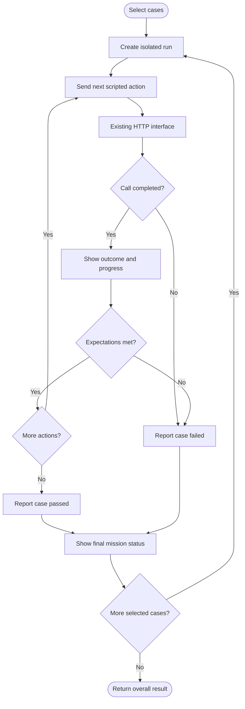

# Scripted rescue simulations flow

**Superseded**: use the canonical [composed timeline](../../../specs/012-simulations/contracts/timeline.md) and [plan](../../../specs/012-simulations/plan.md). This initial flow predates the single-mission composition correction.

Draft supplement to the [short design](2026-11-17-rescue-simulations-design.md), awaiting approval with that design. FR references point to the [specification](../../../specs/012-simulations/spec.md).

Selection and isolation: FR-001. Action outcomes and progress: FR-003 to FR-005. Expectations, mission status and overall result: FR-006/007. HTTP boundary: FR-008. Concurrent actions are one scripted batch; its outcomes are checked without assuming a fixed winner. Mission status is reported only when observed; unavailable state is identified explicitly. Case success does not imply mission completion.
