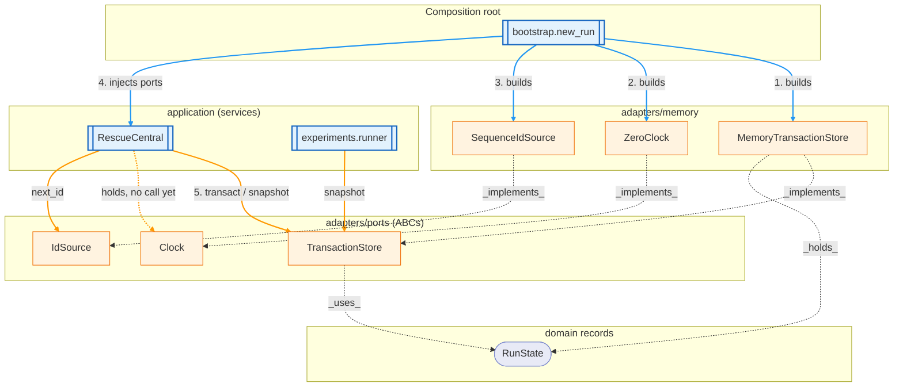
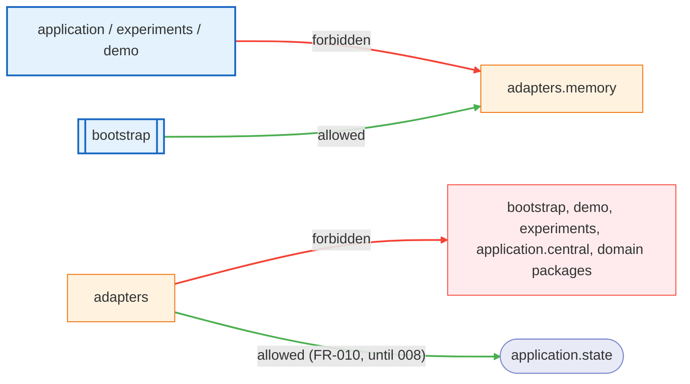
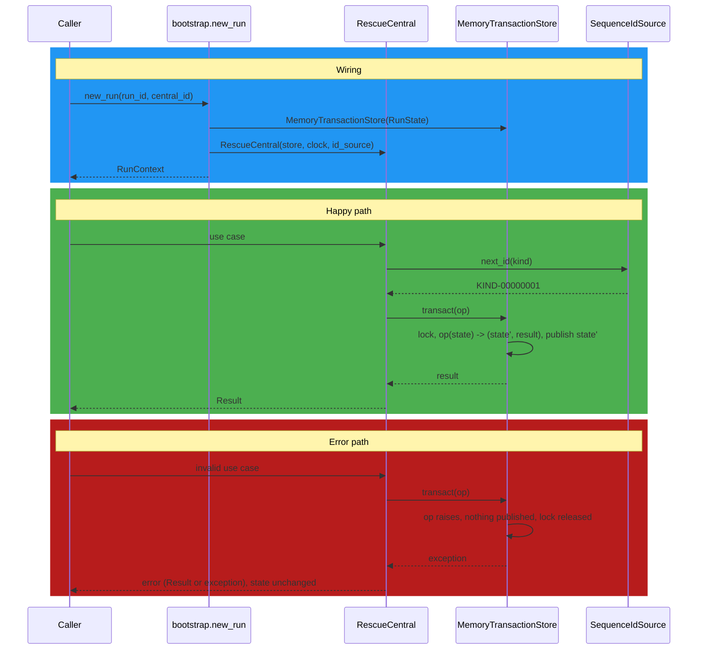
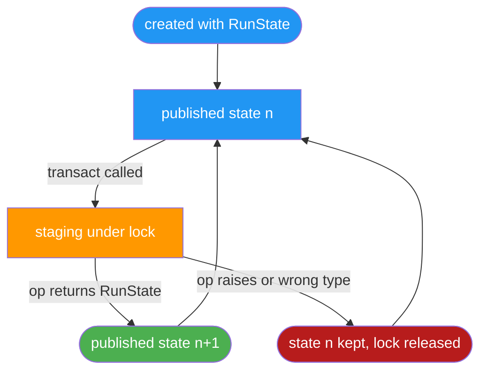
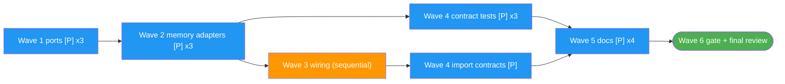

# Design Diagrams: 003-adapters-conformance

**Change**: 003-adapters-conformance | **Design**: [plan.md](plan.md), [data-model.md](data-model.md)

Colors: blue = happy path / wiring, amber = processing, red = blocked import, crimson = error,
green = success. Bold blue nodes are runtime components; orange nodes are ports and adapters;
indigo rounded nodes are domain records.

## 1. Component Dependencies

Import contracts guarding these edges (red = forbidden):

## 2. Sequence Diagram

## 3. State Machines

### 3.1 MemoryTransactionStore

## 4. Delivery Waves (subagent-driven, `[P]` = parallel)

