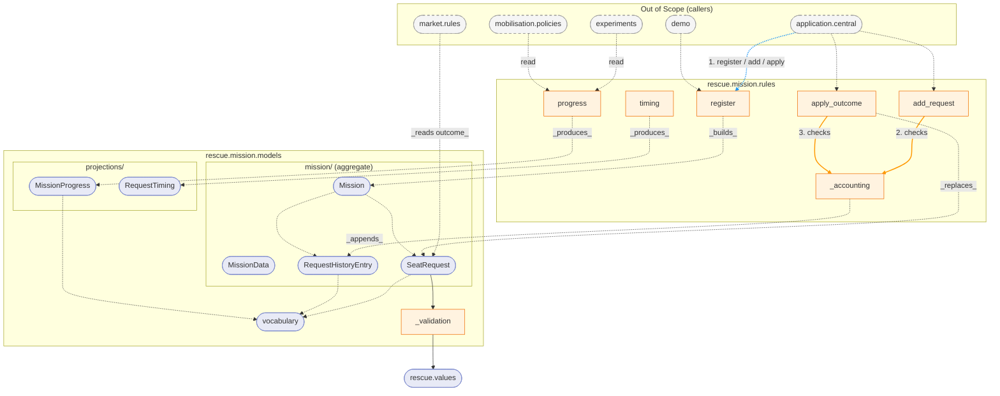
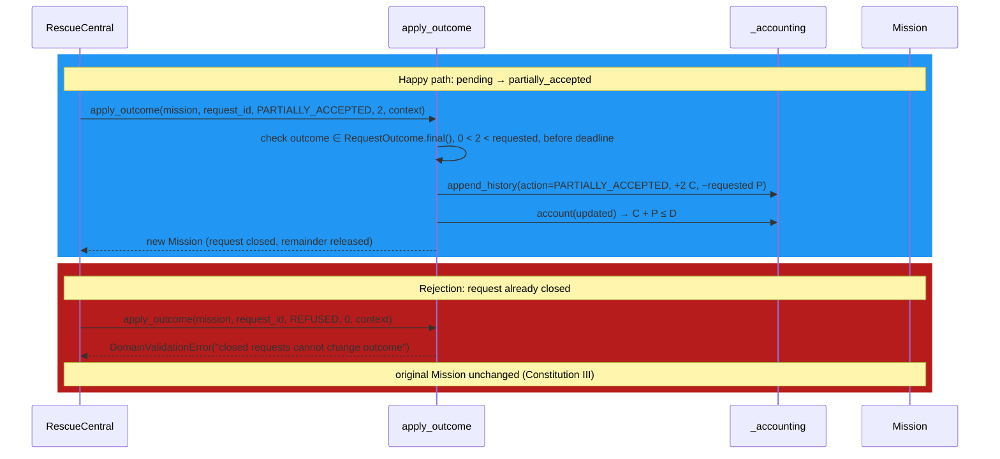
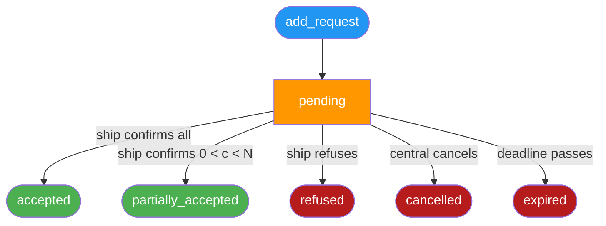
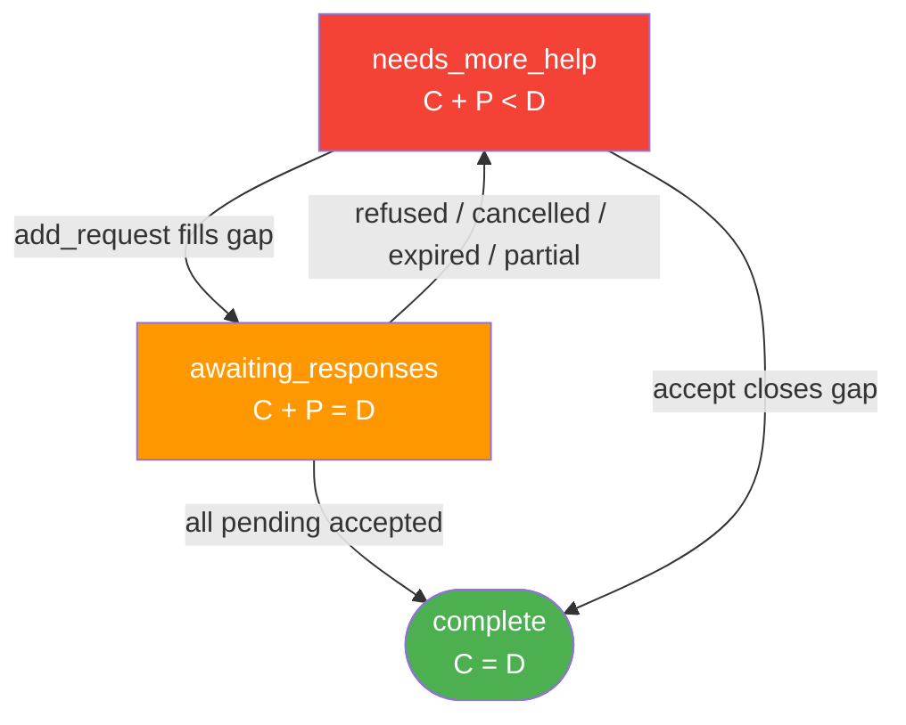

# Design Diagrams: 004 Mission Conformance

**Change**: 004-mission-conformance | **Design**: [plan.md](plan.md), [data-model.md](data-model.md)

## Color Conventions

| Flow Type | Color | Hex |
|-----------|-------|-----|
| Submission / happy-path | blue | `#2196F3` |
| Validation / processing | amber | `#FF9800` |
| Safety / blocking / rejection | red | `#F44336` |
| Routing / delivery / success | green | `#4CAF50` |
| Error / failure | crimson | `#B71C1C` |

## 1. Component Dependencies

Imports point inwards: callers → `rules` → `models` → `rescue.values`. Callers use only the two
package `__init__`s (contracts/public-imports.md).

## 2. Sequence Diagram

`apply_outcome` on a pending request (happy path) and on a closed request (rejection).

## 3. State Machines

### 3.1 SeatRequest

### 3.2 MissionProgress status (derived, not stored)

