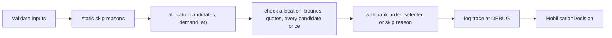

# Data Model: Mobilisation

Source of truth for the persisted entities:
[Mobilisation class diagram](../../docs/architecture/diagrams/rescue-domain-model/namespaces/Mobilisation/class-diagram.mmd)
and [ER diagram](../../docs/architecture/diagrams/rescue-domain-model/namespaces/Mobilisation/entity-relationship-diagram.mmd).
Each model file's docstring names the diagram class it implements. Value objects that live only in
memory (not in the diagrams) are marked *transient*.

| File (`rescue/mobilisation/models/`) | Type | Fields | Rules | Diagram |
|---|---|---|---|---|
| `algorithm_name.py` | `AlgorithmName` StrEnum | `earliest_arrival`, `largest_capacity`, `priority_queue`, `min_cost_flow`, `cp_sat`, `knapsack` | closed set | `MobilisationPolicy.selection_criteria` |
| `policy.py` | `MobilisationPolicy` | `policy_id`, `revision ≥ 1`, `name`, `selection_criteria` | resolved `strategy` must be an `AlgorithmName`, else construction fails | UML/ER `MobilisationPolicy` |
| `candidate.py` | `Candidate` *transient* | `ship_id`, `revision: ShipOfferRevision`, `free_seats ≥ 0`, `quote: RFQOffer?` | `allocatable_seats = min(free_seats, revision.capacity)`; `arrival_instant(candidate)` | input from ShipMarket |
| `decision_context.py` | `DecisionContext` *transient* | `decision_id`, `recorded_at`, `evaluation_ids` | unique ids | — |
| `skip_reason.py` | `SkipReason` StrEnum | `unavailable`, `quote_not_held`, `expired_quote`, `insufficient_demand`, `exhausted`, `quote_exceeds_remaining_demand`, `insufficient_capacity`, `not_chosen` | `static_skip_reason(candidate, at)` returns the first three | `OfferEvaluation.reason` |
| `allocation.py` | `Allocation` *transient* | `ship_id`, `seats ≥ 0` | — | — |
| `allocation.py` | `AllocationResult` *transient* | `algorithm: AlgorithmName`, `allocations: tuple[Allocation, ...]`, `trace: tuple[TraceStep, ...]` | allocation order = rank order | — |
| `trace_step.py` | `TraceStep` *transient* | `algorithm`, `step: str`, `ship_id: Id?`, `detail: tuple[tuple[str, str], ...]` | immutable | — |
| `offer_evaluation.py` | `OfferEvaluation` | unchanged | unchanged invariants | UML/ER `OfferEvaluation` |
| `decision.py` | `MobilisationDecision` | unchanged | unchanged invariants | UML/ER `MobilisationDecision` |

Relationships (unchanged): `MobilisationDecision 0..* → 1 MobilisationPolicy` (applies revision);
`MobilisationDecision 1 *-- 0..* OfferEvaluation` (explains candidates).

Diagram update: `MobilisationPolicy.selection_criteria` gets a note that it resolves to one
`AlgorithmName`, and an `AlgorithmName` enumeration is added to the Mobilisation class diagram.

## Decision flow (services/decide.py)

