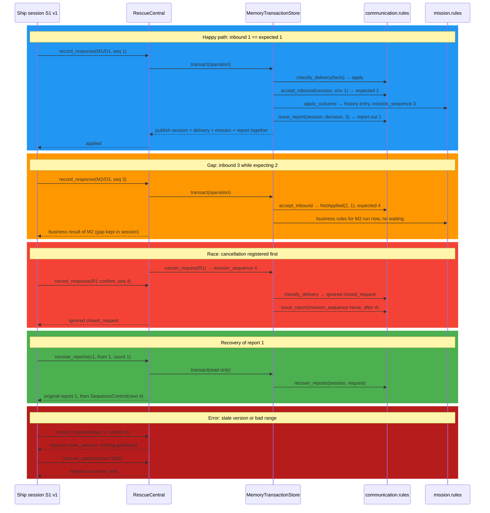
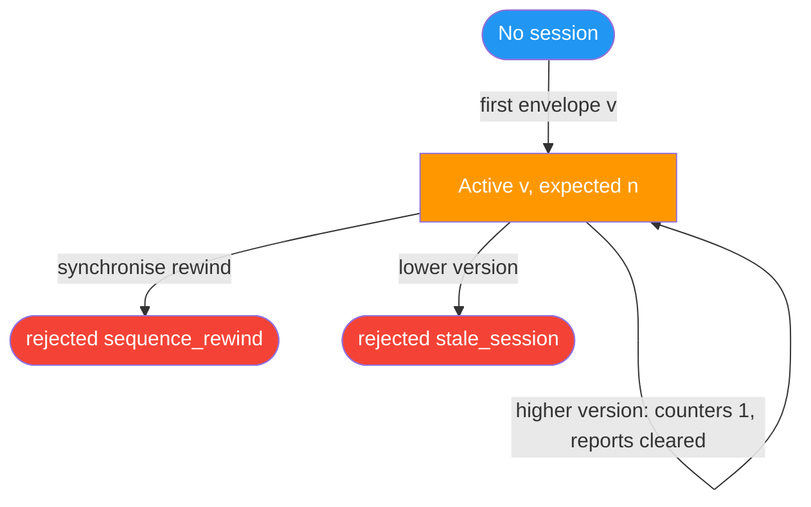
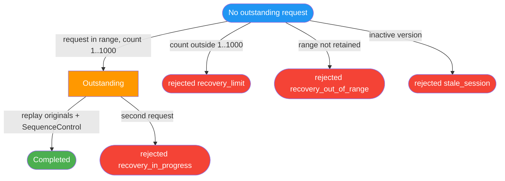
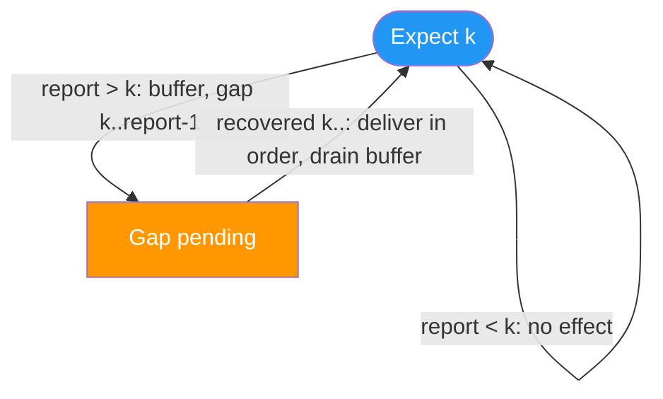

# Design Diagrams: 007 Communication Conformance

**Change**: 007-communication-conformance | **Design**: [plan.md](plan.md), [data-model.md](data-model.md), [research.md](research.md) (P1-P12)

## Color Conventions

| Flow Type | Color | Hex |
|-----------|-------|-----|
| Submission / happy-path | blue | `#2196F3` |
| Validation / processing | amber | `#FF9800` |
| Safety / blocking / rejection | red | `#F44336` |
| Routing / delivery / success | green | `#4CAF50` |
| Error / failure | crimson | `#B71C1C` |

## 1. Component Dependencies

Imports point inwards: `application.central` → `communication.rules` → `communication.models` → `rescue.values`. Communication never imports mission; central converts mission facts to `DeliveryFacts` primitives and reads `mission_sequence` as an `int`.

```mermaid
flowchart TD
    subgraph ext["Out of Scope (callers)"]
        SHIP(["Ship / experiments runner"])
        OP(["Operator / demo"])
    end

    subgraph app["rescue.application (services)"]
        RC[["RescueCentral"]]
        STORE["TransactionStore port"]
    end

    subgraph adapters["rescue.adapters"]
        MEM["MemoryTransactionStore (one lock)"]
    end

    subgraph rules["rescue.communication.rules"]
        CLS["classify_delivery"]
        ACC["accept_inbound"]
        ISS["issue_report"]
        REC["recover_reports"]
        SYN["synchronise_inbound"]
        RCV["receive_report"]
    end

    subgraph models["rescue.communication.models"]
        MSG(["CommunicationMessage"])
        DEL(["MessageDelivery"])
        FACTS(["DeliveryFacts / DeliveryDecision"])
        ENV(["SessionEnvelope"])
        SES(["CommunicationSession"])
        GAP(["NotApplied"])
        REP(["DecisionReport"])
        CUR(["ReportCursor"])
    end

    subgraph mission["rescue.mission (unchanged)"]
        HIST(["RequestHistoryEntry.mission_sequence"])
    end

    SHIP -.->|"1. record_response(envelope)"| RC
    OP -.->|"cancel / expire"| RC
    RC -->|"2. transact"| STORE
    MEM -->|"implements"| STORE
    RC -->|"3. classify"| CLS
    RC -->|"4. sequence"| ACC
    RC -->|"5. apply_outcome"| HIST
    RC -->|"6. report"| ISS
    RC -->|"recover"| REC
    RC -->|"synchronise"| SYN
    SHIP -.->|"cursor"| RCV
    CLS -.->|"_uses_"| FACTS
    ACC -.->|"_updates_"| SES
    ACC -.->|"_produces_"| GAP
    ISS -.->|"_builds_"| REP
    REC -.->|"_reads_"| REP
    RCV -.->|"_updates_"| CUR
    DEL -.->|"_carries_"| ENV
    REP -.->|"_copies_ int"| HIST

    style SHIP stroke-dasharray:5 5,stroke:#999,fill:#f5f5f5,color:#333
    style OP stroke-dasharray:5 5,stroke:#999,fill:#f5f5f5,color:#333
    style RC fill:#E3F2FD,stroke:#1565C0,stroke-width:2px,color:#333
    style STORE fill:#FFF3E0,stroke:#EF6C00,color:#333
    style MEM fill:#FFF3E0,stroke:#EF6C00,color:#333
    style CLS fill:#FFF3E0,stroke:#EF6C00,color:#333
    style ACC fill:#FFF3E0,stroke:#EF6C00,color:#333
    style ISS fill:#FFF3E0,stroke:#EF6C00,color:#333
    style REC fill:#FFF3E0,stroke:#EF6C00,color:#333
    style SYN fill:#FFF3E0,stroke:#EF6C00,color:#333
    style RCV fill:#FFF3E0,stroke:#EF6C00,color:#333
    style MSG fill:#E8EAF6,stroke:#7986CB,color:#333
    style DEL fill:#E8EAF6,stroke:#7986CB,color:#333
    style FACTS fill:#E8EAF6,stroke:#7986CB,color:#333
    style ENV fill:#E8EAF6,stroke:#7986CB,color:#333
    style SES fill:#E8EAF6,stroke:#7986CB,color:#333
    style GAP fill:#E8EAF6,stroke:#7986CB,color:#333
    style REP fill:#E8EAF6,stroke:#7986CB,color:#333
    style CUR fill:#E8EAF6,stroke:#7986CB,color:#333
    style HIST fill:#E8EAF6,stroke:#7986CB,color:#333

    linkStyle 0 stroke:#2196F3,stroke-width:2px
    linkStyle 1 stroke:#2196F3,stroke-width:2px
    linkStyle 2 stroke:#FF9800,stroke-width:2px
    linkStyle 4 stroke:#FF9800,stroke-width:2px
    linkStyle 5 stroke:#FF9800,stroke-width:2px
    linkStyle 6 stroke:#4CAF50,stroke-width:2px
    linkStyle 7 stroke:#4CAF50,stroke-width:2px
```

---

## 2. Sequence Diagram

One `record_response` transaction (research P6, P7), a gap, a race lost to a cancellation, and report recovery.

---

## 3. State Machines

### 3.1 CommunicationSession (inbound expectation)

### 3.2 Report recovery (one session)

### 3.3 ReportCursor (ship side)

