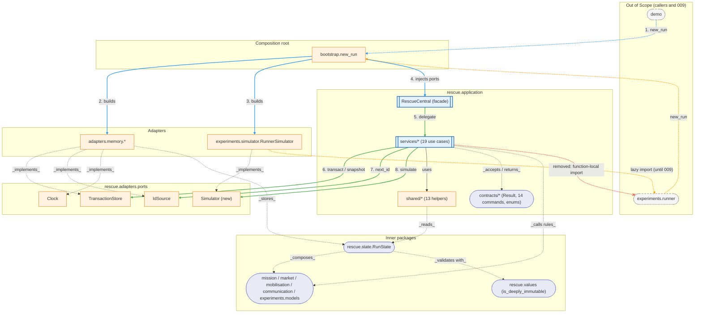
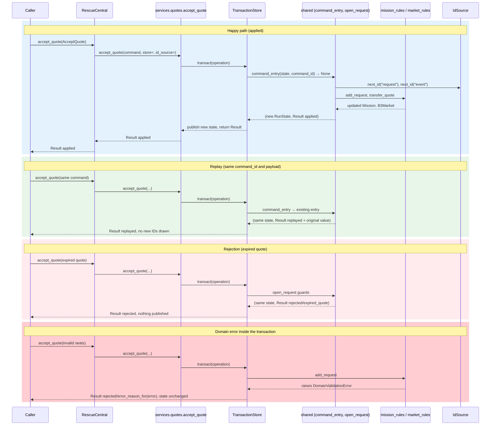
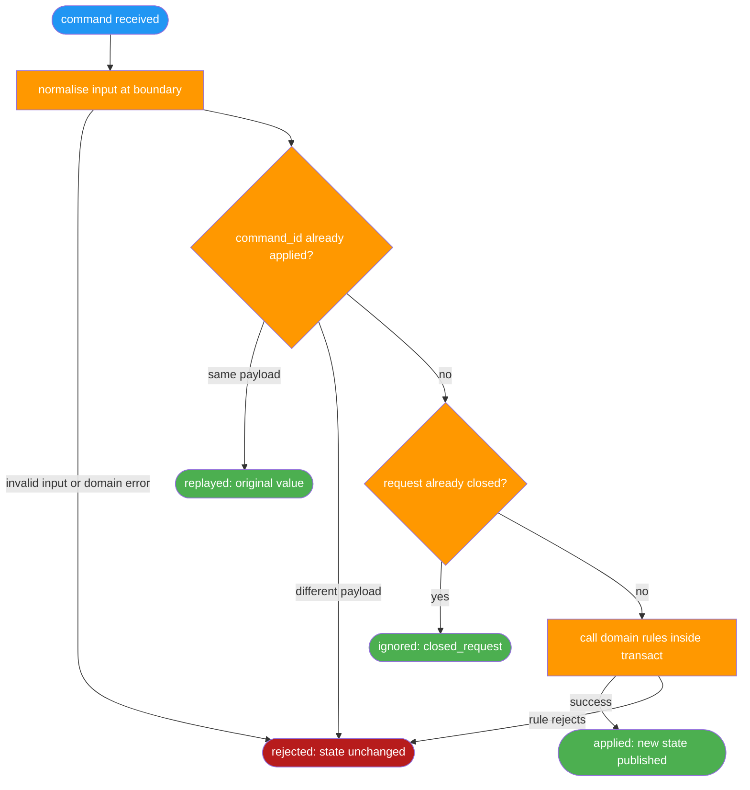
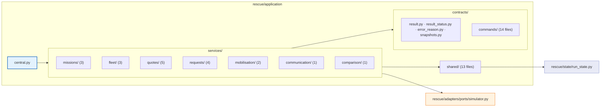

# Design Diagrams: 008 Application Conformance

**Change**: 008-application-conformance | **Design**: [plan.md](plan.md), [data-model.md](data-model.md), [research.md](research.md)

These are feature-level design views. The maintained UML and ER views of the application live in
`docs/architecture/diagrams/rescue-domain-model/namespaces/Application/` (R10).

## Color Conventions

| Flow Type | Color | Hex |
|-----------|-------|-----|
| Submission / happy-path | blue | `#2196F3` |
| Validation / processing | amber | `#FF9800` |
| Safety / blocking / rejection | red | `#F44336` |
| Routing / delivery / success | green | `#4CAF50` |
| Error / failure | crimson | `#B71C1C` |

Node styles: facade and services `fill:#E3F2FD,stroke:#1565C0` (bold); ports and adapters
(service objects) `fill:#FFF3E0,stroke:#EF6C00`; domain and data `fill:#E8EAF6,stroke:#7986CB`
(rounded); out of scope is dashed grey.

## 1. Component Dependencies (target)

Imports point inwards. `-->` is a runtime call to an injected dependency, `-.->` (italic) is a
compile-time use of a domain or data type, and `==>` is a facade-to-service delegation. The red
edge shows the cycle that is removed.

## 2. Sequence Diagram: `accept_quote` through the facade

This shows the happy path, replay, rejection, and a domain error inside the transaction (nothing
is published).

## 3. State Machine: `Result.status` per service call

Not every service has every branch: only command-ID services replay, and only request-closing
services return `ignored`.

## 4. Target Layout

## 5. Wave Dispatch (subagent-driven development)

`[P]` waves fan out to implementers that own disjoint files. The controller gates every wave with
`make check-all`.

```mermaid
flowchart TD
    W0([0 Baseline + rebase gate]) --> W1a
    subgraph W1a["1a [P]"]
        A1["values.is_deeply_immutable"]
        A2["ports/simulator.py"]
    end
    W1a --> W1b["1b rescue/state/ (sequential)"]
    W1b --> W2
    subgraph W2["2 [P] contracts/"]
        B1["core + __init__"]
        B2["commands/"]
    end
    W2 --> W3
    subgraph W3["3 [P] shared/"]
        C1["lookups"]
        C2["request guards"]
        C3["transitions"]
    end
    W3 --> W4
    subgraph W4["4 [P] services/ (one per folder)"]
        D1["missions"]
        D2["fleet"]
        D3["quotes"]
        D4["requests"]
        D5["mobilisation"]
        D6["communication"]
        D7["comparison"]
    end
    W4 --> W5["5 facade + wiring (sequential)"]
    W5 --> W6
    subgraph W6["6 [P] checks"]
        E1["import contracts + cycle test"]
        E2["package_layout + shape test"]
        E3["Makefile coverage"]
    end
    W6 --> W7
    subgraph W7["7 diagrams and docs"]
        F1["[P] UML + ER"]
        F2["[P] README, docs index, roadmap"]
        F3["docstring Diagram: sweep (after F1)"]
    end
    W7 --> W8([8 Gate: check-all, demo cmp, seeded violations])

    style W0 fill:#2196F3,color:#fff
    style W8 fill:#4CAF50,color:#fff
    style W1b fill:#FF9800,color:#fff
    style W5 fill:#FF9800,color:#fff
```

