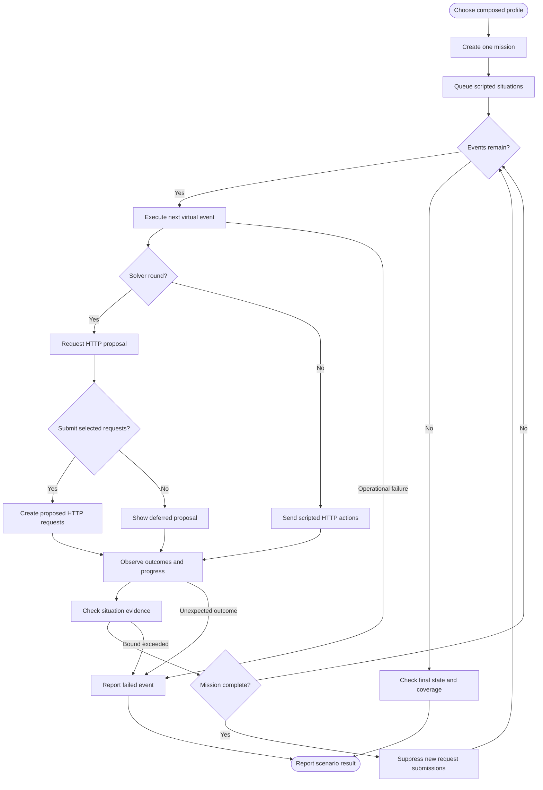

# Composed mission execution

Supplement to the [plan](plan.md); records the composed timeline design, not implemented behavior.

Each profile has one mission and multiple situation recipes (FR-001/002/010). Proposal/submission are distinct (FR-003), observations stream continuously (FR-004/005), and completion does not discard remaining events (FR-008). Final success requires evidence for every included situation and its expected final state (FR-006/009). Failure preserves the observed prefix. all12/all11/all10/baseline share the loop; they do not launch separate missions for each situation.
